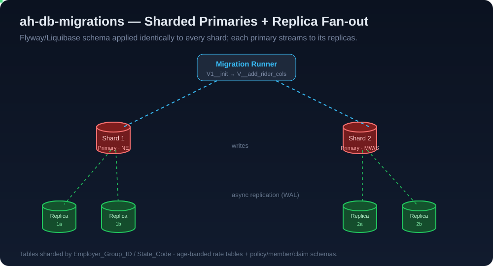
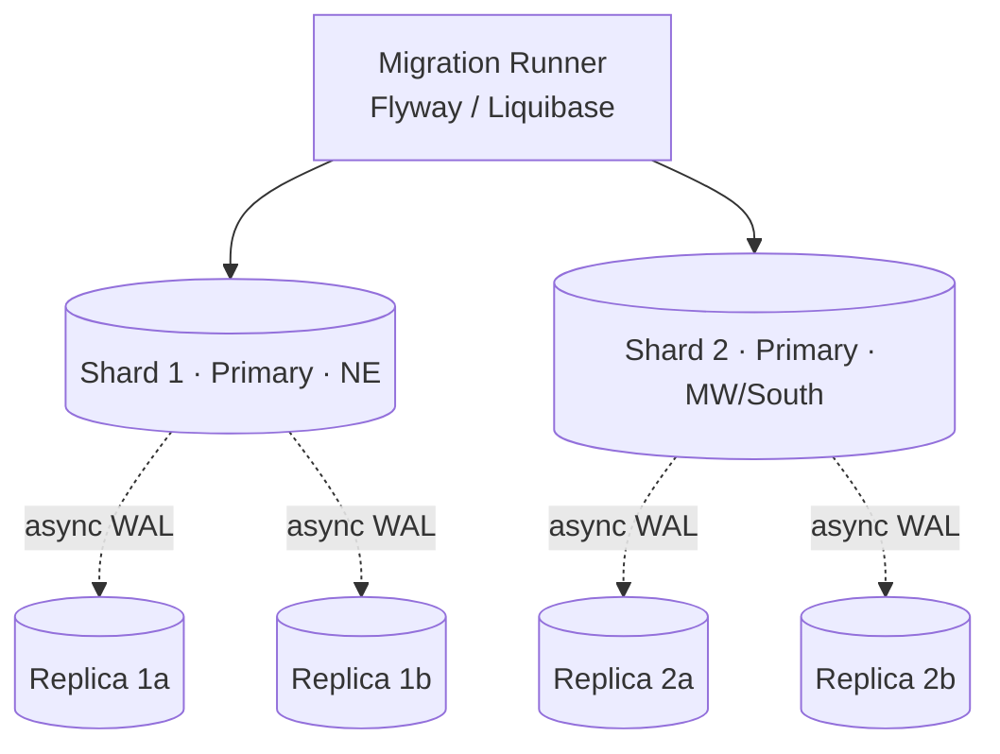
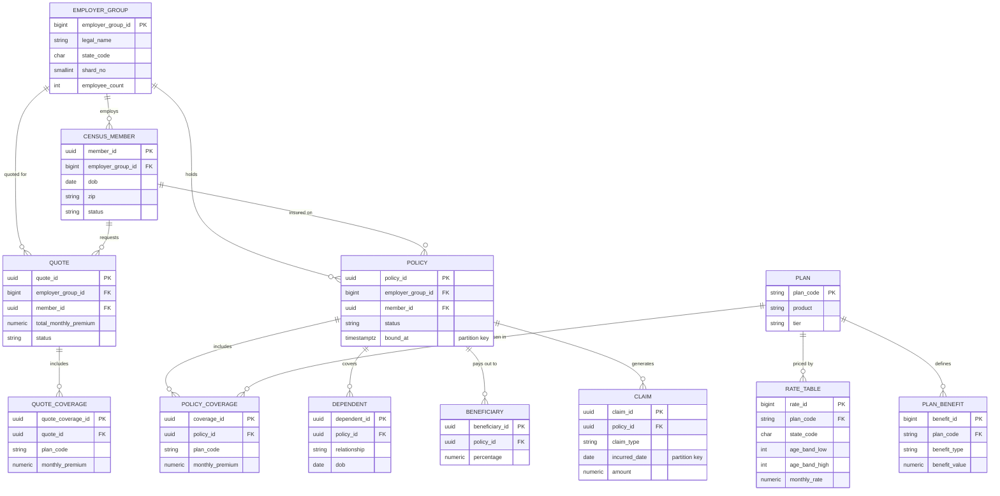
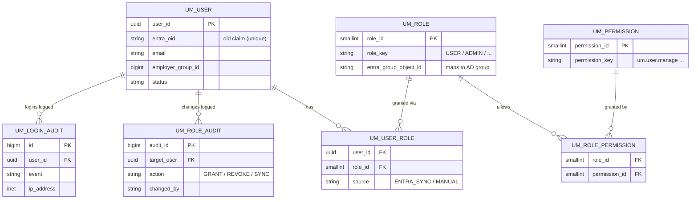

# ah-db-migrations

> **Role:** The single source of truth for the **database layer** — all SQL schema definitions,
> table creations, indexes and versioned migrations for the **sharded primaries** and their
> **read replicas**.

Part of the **A&H Mass Rate-Quote Scalability PoC**:
[`ah-enrollment-ui`](../ah-enrollment-ui) · [`ah-quote-service`](../ah-quote-service) ·
[`ah-policy-data-service`](../ah-policy-data-service) · **`ah-db-migrations`**

---

## Database topology



> The animation shows versioned migrations applied identically to **both shard primaries**,
> each streaming WAL changes to its **read replicas**.



---

## Data model (ER overview)

> Full schema lives in [`migrations/`](migrations) and is validated against PostgreSQL 16.

### A&H domain (sharded by `Employer_Group_ID`)



### User Management (platform/directory DB — not sharded)

> Entra ID security groups are the **source of truth** for role assignment; these tables hold
> the app-side profile, a projection of group→role, a permission matrix, and audit trails.



### Sharding & indexing strategy

| Concern | Decision |
|---|---|
| **Shard key** | `Employer_Group_ID` → `hash(id) % 2` (extendable), or by `State_Code` region |
| **Shard 1 / Shard 2** | Northeast-East / Midwest-South groups, members, quotes, policies, claims |
| **Shard directory** | `shard_map` (central DB) resolves `employer_group_id → shard_no` |
| **Reference data** | `plan`, `plan_benefit`, `rate_table`, `state_regulatory_rule` replicated to every shard + cached in Redis |
| **Hot read index** | `ix_rate_lookup (state_code, plan_code, age_band_*)` INCLUDE `(monthly_rate)` → sub-15 ms quotes |
| **Partitioning** | `policy` RANGE by `bound_at`; `claim` RANGE by `incurred_date` → smaller indexes, easy pruning |
| **User Management** | Lives in the **platform/directory DB** (identity is cross-cutting, not sharded) |
| **Replicas** | Each primary streams async WAL to replicas serving history/dashboard/UM reads (see `V7__read_views.sql`) |

---

## Migration workflow

All files validated end-to-end against **PostgreSQL 16** (schema applies cleanly, composite FKs,
partition routing, and the repeatable seed are all green).

```
migrations/
  V1__reference_rating.sql     -- plan, plan_benefit, rate_table, state_regulatory_rule (+ hot index)
  V2__core_groups_members.sql  -- shard_map, employer_group, census_member
  V3__quotes.sql               -- quote, quote_coverage (durable snapshot; live state in Redis)
  V4__policies.sql             -- policy (partitioned) + policy_coverage, dependent, beneficiary
  V5__claims.sql               -- claim (partitioned by incurred_date)
  V6__user_management.sql      -- um_user, um_role, um_permission, um_user_role, audit tables
  V7__read_views.sql           -- replica-facing views (history, dashboards, effective permissions)
  R__seed_reference.sql        -- repeatable: seed plans, rates, state rules, UM roles & permissions
```

```bash
# Apply the same versioned schema to every shard primary
for DB in $SHARD1_URL $SHARD2_URL; do
  flyway -url="$DB" -locations=filesystem:./migrations migrate
done
# Replicas receive the schema automatically via streaming replication.

# Quick local validation (throwaway container)
docker run -d --name pg -e POSTGRES_PASSWORD=pw -e POSTGRES_DB=ahtest -p 55432:5432 postgres:16
for f in migrations/V*.sql migrations/R__*.sql; do
  PGPASSWORD=pw psql -h localhost -p 55432 -U postgres -d ahtest -v ON_ERROR_STOP=1 -f "$f"
done
```

> **Golden rule:** migrations are **additive and backward-compatible** (expand → migrate →
> contract) so stateless pods can roll without downtime during the Open Enrollment window.

---

## Azure deployment target

- **Azure Database for PostgreSQL – Flexible Server**, one server **per shard** with
  **read replicas**; private endpoints; secrets in **Key Vault**.
- Migrations run from **GitHub Actions / Azure DevOps** against each shard.
- Platform landing-zone + SSO details:
  [`ah-enrollment-ui`](../ah-enrollment-ui#azure-enterprise-landing-zone).
